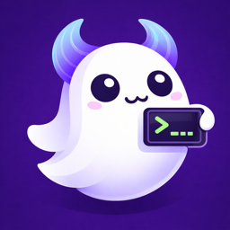

<p align="center">
  
</p>

<h1 align="center">Spectty</h1>

<p align="center">
  A fast, native SSH & Mosh terminal for iOS — Metal-rendered, inspired by <a href="https://github.com/ghostty-org/ghostty">Ghostty</a>, with a clean-room Mosh implementation.
</p>

<p align="center">
  <a href="https://apps.apple.com/app/spectty/id6759269910"></a>
  <a href="https://github.com/ocnc/spectty/actions/workflows/build.yml"></a>
  
  
  
</p>

## Features

- **SSH & Mosh** — connect over SSH or Mosh with automatic reconnection and network roaming
- **Metal renderer** — GPU-accelerated terminal rendering with CoreText glyph atlas
- **Session persistence** — Mosh sessions survive app backgrounding and network switches
- **International input** — native IME composition and basic double-width CJK rendering
- **Terminal controls** — Meta/Alt shortcuts, remote SGR mouse taps, and persistent helper keys
- **On-demand rendering** — idle terminals do not continuously submit frames
- **8 themes** — Default, Catppuccin Mocha, Catppuccin Latte, Tokyo Night, Gruvbox Dark, Dracula, Nord, Monokai
- **Secure** — passwords and keys stored in the iOS Keychain; Secure Enclave support for key generation
- **No tracking** — no accounts, no analytics, no data collection
- **Swift 6** — strict concurrency with async/await throughout

## Architecture

```
┌──────────────────────────────────────────────────────┐
│  SwiftUI App Shell                                   │
│  ConnectionList → SessionManager → TerminalSession   │
│  MoshSessionStore (Keychain persistence)             │
└──────────────┬───────────────────────────────────────┘
               │
┌──────────────▼───────────────────────────────────────┐
│  SpecttyUI                                           │
│  TerminalMetalView (MTKView) + Metal glyph atlas     │
│  TerminalView (UIViewRepresentable)                  │
│  InputAccessory, GestureHandler                      │
└──────────────┬───────────────────────────────────────┘
               │ reads state from
┌──────────────▼───────────────────────────────────────┐
│  SpecttyTerminal                                     │
│  libghostty-vt 1.0.1 (native terminal engine)        │
│  TerminalState (grid, cursor, modes, scrollback)     │
│  KeyEncoder (native legacy / Kitty protocols)        │
│  Kitty image placements → Metal textures             │
└──────────────┬───────────────────────────────────────┘
               │ TerminalEmulator protocol
┌──────────────▼───────────────────────────────────────┐
│  SpecttyTransport                                    │
│  SSHTransport (SwiftNIO SSH)                         │
│  MoshTransport (clean-room Swift)                    │
│    MoshBootstrap (SSH exec → mosh-server)            │
│    MoshSSP (State Synchronization Protocol)          │
│    MoshNetwork (UDP via Network.framework)            │
│    MoshCrypto (AES-128-OCB3 via CommonCrypto)        │
│    STUNClient (NAT traversal diagnostics)            │
│  TerminalTransport / ResumableTransport protocols    │
└──────────────┬───────────────────────────────────────┘
               │
┌──────────────▼───────────────────────────────────────┐
│  SpecttyKeychain                                     │
│  iOS Keychain storage, Ed25519/ECDSA generation,     │
│  Secure Enclave, OpenSSH key import                  │
└──────────────────────────────────────────────────────┘
```

**Data flow:**
```
Keyboard → KeyEncoder → Transport → Remote Server
                                         │
 TerminalMetalView ← TerminalState ← libghostty-vt ← Transport
```

## Packages

| Package | Purpose |
|---------|---------|
| `SpecttyTerminal` | VT100/xterm state machine, cell model, scrollback buffer, key encoder |
| `SpecttyTransport` | SSH (SwiftNIO SSH) and Mosh transports behind `TerminalTransport` protocol |
| `SpecttyUI` | Metal renderer with CoreText glyph atlas, SwiftUI wrapper, input accessory bar, gestures |
| `SpecttySpeech` | Optional Parakeet Ultra download, integrity verification, storage/network policy, and local speech inference |
| `SpecttyKeychain` | iOS Keychain key storage, Ed25519/ECDSA/Secure Enclave generation, OpenSSH PEM import |

## Voice Input

Enable voice in Settings → Voice. Downloads use Wi-Fi unless you explicitly allow
cellular data for that attempt; Low Data Mode is respected. Keep Spectty open during
setup. Retry resumes supported partial transfers and reuses verified files.

In a connected terminal, tap the microphone in the bottom input bar, speak, tap Stop Recording, review, then Insert Text.
Insertion does not send Return. Disabling voice retains the model; Remove Download
deletes it. Existing downloads are verified locally when upgrading.

`SpecttySpeech` bundles an immutable Ultra revision and SHA-256 manifest in
`Resources/Ultra.json`. Changing models requires updating that manifest and testing
the matching artifacts. Installation verifies every file before Core ML loading and
writes the revision marker only after preparation succeeds. It checks available
storage for missing files plus a 1 GB preparation reserve; device-specific cache
requirements may still vary. Models are excluded from backups.

Run `python3 scripts/test-speech.py` to test installation and cancellation/resume
against a local HTTP fixture without downloading model weights.

The compact terminal bar keeps Esc, Tab, Ctrl, and Shift visible. The keyboard
button expands Alt, arrows, and Newline (Ctrl+J). Modifiers apply to the next key.

## Mosh Implementation

Clean-room Swift implementation — no GPL code. Key components:

- **MoshBootstrap**: SSH exec → `mosh-server new` → parse `MOSH CONNECT <port> <key>` → close SSH
- **MoshCrypto**: AES-128-OCB3 (RFC 7253) using CommonCrypto's AES-ECB as the block cipher
- **MoshNetwork**: UDP transport via Network.framework with connection replacement for roaming
- **MoshSSP**: State Synchronization Protocol — sequence-numbered diffs with heartbeat/retransmit
- **Session resumption**: Credentials + SSP sequence numbers persisted to Keychain; reconnect skips SSH bootstrap entirely since mosh-server is daemonized
- **STUNClient**: Minimal RFC 5389 Binding Request for NAT type diagnostics

## libghostty Integration

Spectty uses the official **libghostty-vt 1.0.1** XCFramework, pinned by SHA-256 in `Packages/SpecttyTerminal/Package.swift`. SwiftPM downloads the iOS, simulator, and macOS artifacts; a local Zig build is not required.

The native library owns parsing, screen state, scrollback, keyboard encoding, and Kitty graphics placement/animation. Its PNG callback uses Apple ImageIO with the native image allocation budget. Swift exposes visible cells and reads history on demand. Spectty's Metal renderer draws images in the native layer order and schedules animation frames only while the view is visible. It also honors application cursor shapes and synchronized-output holds (with a one-second timeout), renders bold/italic text and underline/strikethrough decorations, and shapes each cell with Core Text. OSC 8 HTTP(S) links retain their destinations through scrollback. Native bell callbacks trigger the visual bell, and enabled focus reports follow keyboard focus, session switches, and app backgrounding.

Kitty graphics are intended for **SSH sessions**, using direct transmission (for example `kitten icat --transfer-mode=stream image.png`). Local file and shared-memory image loading are disabled: remote programs cannot access files on the phone. Standard `mosh-server` does not carry Kitty graphics; see [Mosh's upstream tracking issue](https://github.com/mobile-shell/mosh/issues/1248).

Native terminal and image tests run with `swift test --package-path Packages/SpecttyTerminal`. GPU layering/clipping and UI regressions run through the `SpecttyUI` package's iOS simulator test scheme.

## Build

Requires Xcode 26.2+, iOS 18+ deployment target.

```bash
xcodebuild build -scheme Spectty -destination 'generic/platform=iOS'
```

## Contributor acknowledgments

Terminal rendering, keyboard, CJK/IME, mouse tap, port entry, and helper-bar
improvements were adapted from [jiedo/spectty](https://github.com/jiedo/spectty),
authored by nandhh. Imported commits retain author credit; adapted changes
record their source commits and co-author trailers. CJK support currently covers
common single-scalar characters, not complete Unicode grapheme shaping.
